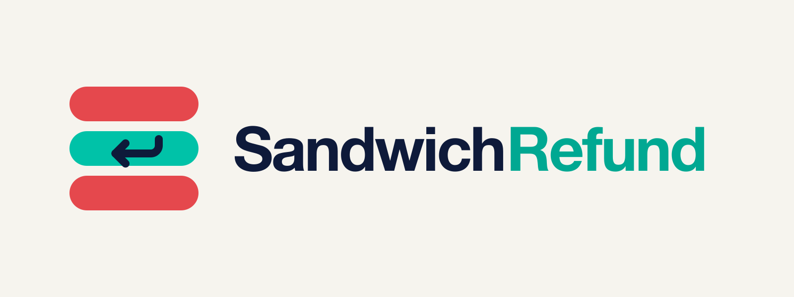

# SandwichRefund

**Refunds for sandwiched swaps, decided by code from Ethereum chain data.** A sponsor (a wallet, a DEX front-end, a
protocol) funds a refund pool on GenLayer for the swaps its routers send. Anyone files a victim transaction; GenLayer
validators read it and the pool's Swap logs from two Ethereum RPCs that must agree, and code decides. A classic
same-block sandwich is refunded to the victim at once, in GEN, at the attacker's net profit. Nobody approves anything.

Live: **https://sandwichrefund.vercel.app** · Rules: [docs/RULES.md](docs/RULES.md) · Seeds: [docs/SEEDS.md](docs/SEEDS.md) ·
Feasibility: [docs/FEASIBILITY.md](docs/FEASIBILITY.md) · Real-world check: [docs/REAL_WORLD_CHECK.md](docs/REAL_WORLD_CHECK.md) ·
Attack round: [docs/ATTACK_REPORT.md](docs/ATTACK_REPORT.md) · Final check: [docs/FINAL_CHECK.md](docs/FINAL_CHECK.md)

## What and why

Sandwich bots watch the public mempool, buy just before a user's swap and sell just after it, in the same block, and
keep the difference; on Ethereum one bot, jaredfromsubway.eth, runs most of them. The user sees only a worse price. The
wallet or front-end that routed the swap cannot prove what happened, let alone repay it.

SandwichRefund turns "we cover our users" into an escrow with arithmetic. The sponsor locks GEN and freezes its terms:
which routers, which pool types, which blocks, how much GEN per unit of attacker profit, the caps. Each swap is a fact
on Ethereum: its transaction, its receipt and every Swap log on its pool in its block. Validators agree on those facts by
reading them twice, and the verdict and the refund follow from code.

## How the rules work

1. **The pool is frozen.** Chains, covered routers (the victim transaction's `to` must be one), Uniswap V2-style and/or
   V3-style pools, a block range, a refund rate per profit token, the maximum per swap and per victim, a claim period,
   the pool's GEN. The sponsor may only top up or extend; there is no cancel.
2. **A case is read twice.** (pool, chain, victim tx hash). Every validator reads the transaction, its receipt, its
   pools' tokens and factories and all their Swap logs in the block and the next, from two RPCs; the answers must be
   identical, the block finalized, the transaction successful, its router covered, its block in range, its pool one
   that its factory knows.
3. **SANDWICHED only if** a front-run at a lower index and a back-run at a higher index in the same block, by the same
   EOA or paid to the same Swap recipient, on the same pool as the victim, the front-run in the victim's direction and
   the back-run opposite, and the attacker's net amount of the profit token positive. The loss estimate is that net
   profit (conservative). Multi-hop victims, several attackers, several victims in one pair, a back-run in the next
   block, a self-sandwich, no profit, an unpriced token: UNCLEAR. No pattern: CLEAN. An RPC error or disagreement:
   UNVERIFIABLE, never a verdict; it can be filed again.
4. **Refund** = min(loss × rate, max per swap, what is left of the victim's cap, the pool's balance), pushed to the
   victim (`tx.from`) in the same transaction. Each pool decides each case once.
5. **Close.** After the claim period anyone closes the pool and the rest goes back to the sponsor. Every GEN has an exit.
6. **MEVGate** answers other contracts per case and per address: NO_POOL, NOT_COVERED, CLEAN, SANDWICHED_REFUNDED,
   SANDWICHED_UNPAID, UNCLEAR, UNVERIFIABLE, with totals; never favorable on missing data.

The exact rule, every reason code and every constant are in [docs/RULES.md](docs/RULES.md); the site's /docs page is
that file.

## Scope

SandwichRefund detects the classic same-pool sandwich within one block: a front-run and a back-run by one actor on the
victim's own Uniswap V2 or V3 pool around the victim's single swap. The refund is the attacker's net profit on that
pool, a conservative estimate of the victim's loss. Other forms of MEV (multi-pool sandwiches, bundles with several
victims, back-runs in later blocks, just-in-time liquidity) are ruled UNCLEAR when they show in the victim's pool and are
not otherwise looked for. Ethereum is covered; the chain table holds one chain.

## Addresses (GenLayer Studio Dev, chain 61997)

| contract | address |
|---|---|
| SandwichRefund (canonical) | `0x0D1fa49E0d39Ed8a592cB1f87e21BD825a644EFA` |
| SandwichRefundDemo | `0xa71645751e3D59Eb51809e76570f367D4F14841c` |
| MEVGate (on canonical) | `0x96D529d8f63EC5D742907DfaE83A02627D35E1e9` |
| MEVGateDemo | `0xe4Aa8409E0EE567868be43387aDF4B497202DBCE` |

All four were deployed from commit `47195a18976f2004ea5a26bd34dc1a23dccb51bd` ([deployments.json](deployments.json)); the first deployment's evidence is in [docs/superseded/v1](docs/superseded/v1).

## Real data

[docs/FEASIBILITY.md](docs/FEASIBILITY.md): 65 real Ethereum swaps through 11 covered routers (Uniswap Universal
Router, V2 Router02, SwapRouter02, 1inch, 0x, KyberSwap, OKX, LI.FI) in blocks 26230913-26232413: 18 sandwiched (by
jaredfromsubway.eth and 8 other bots), 16 clean, 31 ambiguous, read from two RPCs on a Mac and inside GenVM with
identical results. The canonical pool covers exactly those routers and blocks; the keeper filed every case and every
sandwiched victim was refunded on chain ([docs/SEEDS.md](docs/SEEDS.md)). Each SANDWICHED and CLEAN verdict was
cross-checked against chain data the rule does not use ([docs/REAL_WORLD_CHECK.md](docs/REAL_WORLD_CHECK.md)).

## Verify

    git clone https://github.com/kenil1710/sandwichrefund && cd sandwichrefund
    (cd test && npm ci) && sh test/run_offline.sh     # the offline suite: contracts, keeper, meaning, attacks
    pip install -r tests/direct/requirements.txt && python -m pytest tests/direct   # GenLayer Direct Mode
    node tools/verify_source.mjs                       # on-chain code == build/ at the deploy commit, byte for byte
    node tools/feasibility.mjs                         # re-read every real case from both RPCs
    node tools/final_check.mjs                         # everything at once -> docs/FINAL_CHECK.md

The site's [/verify](https://sandwichrefund.vercel.app/verify) page reads the code back from Studio Dev and compares
it with GitHub live.

## Layout

- `contracts/` SandwichRefund and MEVGate; `contracts/shared/` the rule (`common.py`) and the read (`rpc.py`);
  `build/` the deployed bytes (`tools/build.py` inlines the helpers).
- `tools/keeper.mjs` + `tools/lib/keeper_core.mjs` the keeper (GitHub Actions, hourly and 6-hourly; checkpoints on the
  `keeper-state` branch); `tools/lib/sandwich.mjs` the off-chain mirror of the read and the rule.
- `test/` the offline suite (stubbed GenVM, mock Ethereum RPCs), deploy, seed and demo scripts.
- `frontend/` the site (Next.js on Vercel).
